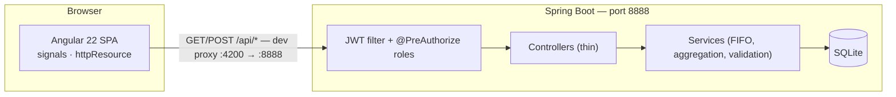

# Smart Inventory System

**Full-stack warehouse management application, built and documented end-to-end to industrial standards.**
Spring Boot 4 backend · Angular 22 frontend (signals) · JWT security · FIFO stock logic · a complete SDLC documentation trail.

> **For reviewers:** the parts worth looking at first are marked in [Engineering highlights](#engineering-highlights). The full story — requirements, architecture decisions, security model, QA report — lives in [`docs/`](#documentation).

## At a glance

| | |
|---|---|
| **Backend** | Java 21 · Spring Boot 4.1 · SQLite · Maven |
| **Frontend** | Angular 22 (signals, `httpResource`) · strict TypeScript · Yarn 4 |
| **Security** | JWT authentication · role-based access (`WORKER` / `MANAGER` / `ADMIN`) via method-level `@PreAuthorize` |
| **Testing** | Frontend: **116 unit tests green** (Vitest + jsdom) · Backend: JUnit 5 + Mockito, JaCoCo ~97%, Pitest mutation testing |
| **Deployment** | Docker multi-stage builds · docker-compose stack (Nginx reverse proxy + Spring Boot) |
| **Documentation** | Full SDLC trail in [`docs/`](#documentation): analysis → design → implementation → QA → roadmap |

## What it does

- **Authentication & roles** — JWT login; three roles with different permissions (e.g. only managers create products and manage locations).
- **Product management** — product catalog with SKU, category and minimum stock level.
- **Goods receipt & issue** — receiving into location codes; issuing with automatic **FIFO batch selection**; the backend returns German business messages that the UI renders directly.
- **Dashboard** — KPI cards (products, total units, locations, low-stock warnings) plus a low-stock-first inventory table, fully reactive via Angular signals.

## Engineering highlights

1. **Angular 20+ reactivity without NgRx.** Data access is built on `httpResource()` — auto-loading signal resources with `.reload()`, default values and error state; components stay thin declarative templates. See [`dashboard-service.ts`](src/frontend/src/app/features/inventory/services/dashboard-service.ts) and its [spec](src/frontend/src/app/features/inventory/services/dashboard-service.spec.ts).
2. **IHK layering discipline.** Controllers are thin (routing, DTO mapping, `@PreAuthorize`); all business rules — FIFO batch selection, stock aggregation, low-stock calculation, validation with German messages — live in the service layer (`com.sisie.core.service`).
3. **Test pyramid on both sides.** Frontend: service specs with `HttpTestingController`, component specs rendering real templates (116 tests). Backend: unit + slice tests, JaCoCo ~97%, and Pitest to catch "fake coverage". See the [QA report](docs/04_quality_assurance/testing_report.md) and the hands-on [testing guide](docs/04_quality_assurance/testing_guide.md).
4. **Documentation as a first-class deliverable.** Every phase is documented: requirements, architecture + ERD, security model, technology selection with trade-offs, progress log, QA report, roadmap.

## Architecture



## Repository map

| Path | What's there |
|---|---|
| [`src/backend/`](src/backend/) | Spring Boot application (Maven) — [README](src/backend/README.md) |
| [`src/frontend/`](src/frontend/) | Angular 22 SPA — [README](src/frontend/README.md) |
| `docs/01_analysis/` | Requirements |
| `docs/02_design/` | Architecture, database model + ERD, security model, technology selection |
| `docs/03_implementation/` | Progress log per phase |
| `docs/04_quality_assurance/` | Testing guide (frontend) + QA report (both sides) |
| `docs/05_roadmap/` | What's next: Docker, CI/CD, multi-warehouse |

## Quick start

**Docker (full stack, one command):**

```bash
docker compose up -d --build
# → http://localhost:8081  (Nginx serves the Angular SPA and proxies /api/* to Spring Boot)
```

Demo accounts are seeded on first start: `admin`/`Admin123!`, `manager`/`Manager123!`, `worker`/`Worker123!`. The SQLite database persists in `./data/`.

**Backend (dev mode)** — Java 21, Maven:

```bash
cd src/backend
./run-backend.sh start     # or: mvn spring-boot:run
# → http://127.0.0.1:8888
```

**Frontend** — Node.js 20+, Yarn 4:

```bash
cd src/frontend
yarn install
yarn start                 # → http://localhost:4200, proxies /api/* to :8888
```

Start the backend first — otherwise API calls fail with connection refused.

## Testing

| Side | Command (from module dir) | Status |
|---|---|---|
| Frontend | `yarn test:run` in `src/frontend/` | **116 tests, all green** (Vitest + jsdom) |
| Backend | `mvn test` in `src/backend/` | JUnit 5 + Mockito · JaCoCo ~97% · Pitest |

How to write new tests: [testing guide](docs/04_quality_assurance/testing_guide.md) · results and coverage analysis: [QA report](docs/04_quality_assurance/testing_report.md).

## Roadmap

**Done:** Docker (multi-stage builds, compose stack) · **In progress:** GitHub Actions CI/CD (build → tests/JaCoCo → Trivy security scan → GHCR image push) · **Next:** multi-warehouse support, audit logging, OpenAPI/Swagger — see the [roadmap](docs/05_roadmap/roadmap.md).
