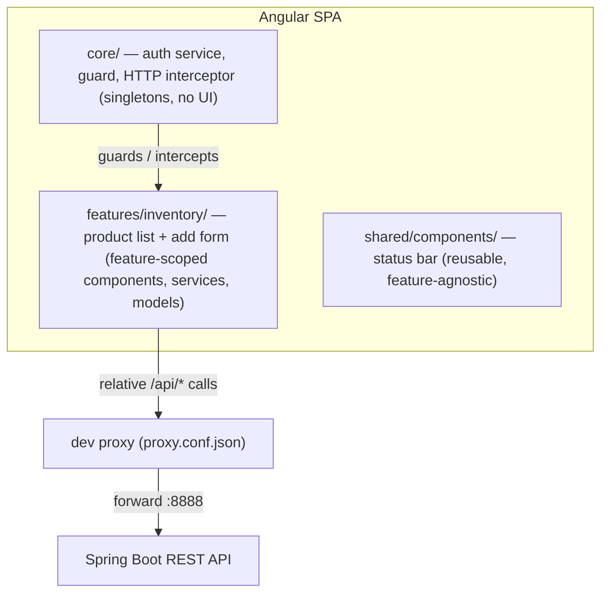

# Software Architecture Design (SAD) - SIS-IE

## 1. Architectural Pattern: Layered Architecture
The system follows a strict **Layered Architecture** to ensure separation of concerns, maintainability, and testability. This approach is chosen to meet industrial standards for enterprise software.

### 1.1 Layers Description
| Layer | Responsibility | Key Components | Interaction |
| :--- | :--- | :--- | :--- |
| **Controller (API)** | Handles HTTP requests, validates input DTOs, and returns appropriate HTTP status codes. | `LogisticsController`, `AuthController` | Calls $\rightarrow$ Service Layer |
| **Service (Business)** | Contains the core business logic (e.g., FIFO calculation, Auth logic). Orchestrates data flow. | `InventoryService`, `AuthService` | Calls $\rightarrow$ Repository Layer |
| **Repository (Data)** | Abstracts database access. Performs CRUD operations on entities. | `StockRepository`, `UserRepository` | Calls $\rightarrow$ Database |
| **Model/Entity** | Represents the data structure in the database. | `StockBatch`, `User` | Used by all layers |
| **DTO (Transfer)** | Decouples internal entities from external API contracts for security and stability. | `ReceiveRequest`, `IssueRequest` | Controller $\leftrightarrow$ Client |

## 2. Design Principles Applied
- **Single Responsibility Principle (SRP):** Each class has one reason to change (e.g., the Repository only handles DB queries).
- **Dependency Injection (DI):** Services are injected into Controllers via constructor injection (`@RequiredArgsConstructor`), enabling easy mocking during tests.
- **Statelessness:** The backend is stateless using JWT, allowing for horizontal scaling in cloud environments.

## 3. Data Flow Example: Goods Receipt
1. Client sends `POST /api/logistics/receive` with a JSON body.
2. **Controller** receives the `ReceiveRequest` DTO and passes it to the Service.
3. **Service** calculates if new batches are needed and calls the Repository.
4. **Repository** saves the data to the SQLite/PostgreSQL database.
5. **Controller** returns a success message (`200 OK`).

## 4. Frontend Architecture (Angular SPA)
The client is an Angular 22 single-page application using standalone components and signals, organized by feature rather than by file type:

- **`core/`**: application-wide singletons — `AuthService`, `authGuard`, the JWT HTTP interceptor. No feature logic, no UI beyond login.
- **`features/inventory/`**: self-contained feature with its own components, services and models; talks to the backend only through relative URLs (`/api/products`).
- **`shared/components/`**: reusable UI (status bar) that knows nothing about specific features — it reads auth state from `AuthService`.
- **Development wiring**: `ng serve --proxy-config proxy.conf.json` forwards `/api/*` to the backend on port 8888, so no CORS configuration and no hard-coded host in frontend code. In production the same contract is served by a reverse proxy (see Roadmap Phase 5).

This mirrors the backend's layering: `core` ≈ cross-cutting concerns, `features` ≈ controllers/services of the UI, `shared` ≈ reusable DTOs/components.
