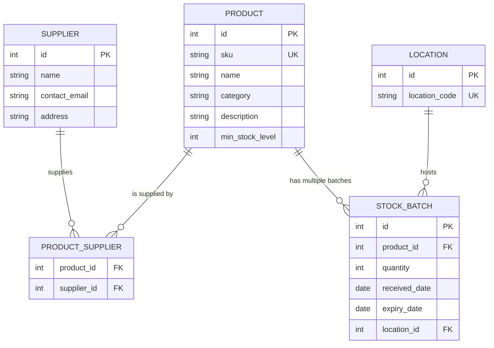

# Database Entity Relationship Diagram (ERD)

This document describes the data structure of the Smart Inventory System for Industrial Electronics (SIS-IE).

## ER Diagram

## Design Decisions
1. **Many-to-Many (Product <-> Supplier):** Implemented via the `PRODUCT_SUPPLIER` join table to allow flexibility in sourcing components from multiple vendors.
2. **FIFO Implementation:** The `STOCK_BATCH` entity tracks the `received_date`. To implement FIFO, the system will always query for the batch with the oldest `received_date` first.
3. **Location Tracking:** Instead of putting a location directly on the product, we put it on the `STOCK_BATCH`. This allows the same product to be stored in different shelves (e.g., some in Shelf A and some in Shelf B).
4. **Data Integrity:** All relationships are enforced via Foreign Keys (FK) to ensure no "orphan" data exists.
