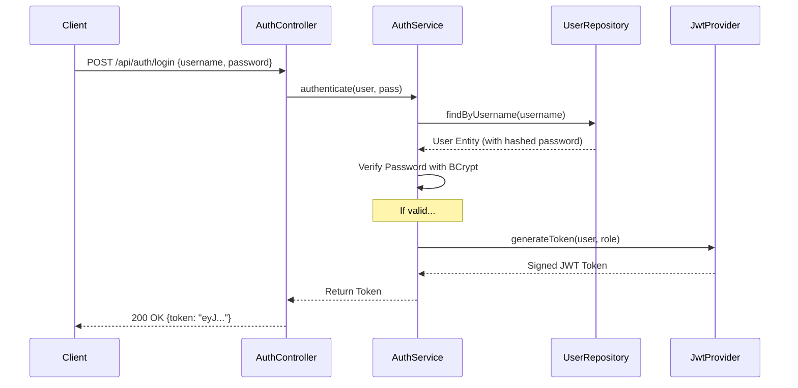

# Security & Access Management Design (SAMD)
Project: Smart Inventory System for Industrial Electronics (SIS-IE)
Version: 1.0
Status: Draft/Review

## 1. Overview
The goal of the security module is to protect the system from unauthorized access and ensure that users can only perform actions permitted by their assigned role. We implement a **Stateless Authentication** mechanism using **JWT (JSON Web Tokens)**.

## 2. User & Role Model
To maintain simplicity while ensuring scalability, we use a Role-Based Access Control (RBAC) system.

### 2.1 The User Entity
The `User` entity will be stored in the database with the following attributes:
| Attribute | Type | Constraint | Description |
| :--- | :--- | :--- | :--- |
| `id` | Long | Primary Key | Auto-generated unique ID. |
| `username` | String | Unique, Not Null | The login name of the user. |
| `password` | String | Not Null | **Hashed** password (using BCrypt). Never store plain text! |
| `role` | Enum | Not Null | The assigned role (`ROLE_WORKER` or `ROLE_MANAGER`). |

### 2.2 Role Definitions
| Role | Permissions | Business Logic |
| :--- | :--- | :--- |
| **ROLE_WORKER** | Read-only Products, Execute Logistics (Receive/Issue) | Can manage stock but cannot change product definitions or delete data. |
| **ROLE_MANAGER** | Full Access (CRUD on all entities), User Management | Can create/edit products and suppliers; can override stock levels. |

## 3. Authentication Flow (JWT)
We use JWT because it is stateless, meaning the server doesn't need to store session data in memory, making the app faster and easier to scale.

### 3.1 Login Process

### 3.2 Request Authorization Process
Every protected request must include the token in the header: `Authorization: Bearer <token>`.

1. **Request** arrives at the server.
2. **JwtFilter** intercepts the request.
3. **JwtProvider** validates the signature and expiration of the token.
4. **SecurityContext** is populated with the user's identity and role.
5. **Spring Security** checks if the role has access to the requested endpoint.

## 4. Security Standards (Compliance)
- **Password Hashing**: Use `BCryptPasswordEncoder` to prevent rainbow table attacks.
- **Token Expiration**: Tokens will expire after 24 hours to limit the window of opportunity for stolen tokens.
- **Statelessness**: No HTTP Session is used; all identity information is contained within the JWT.
